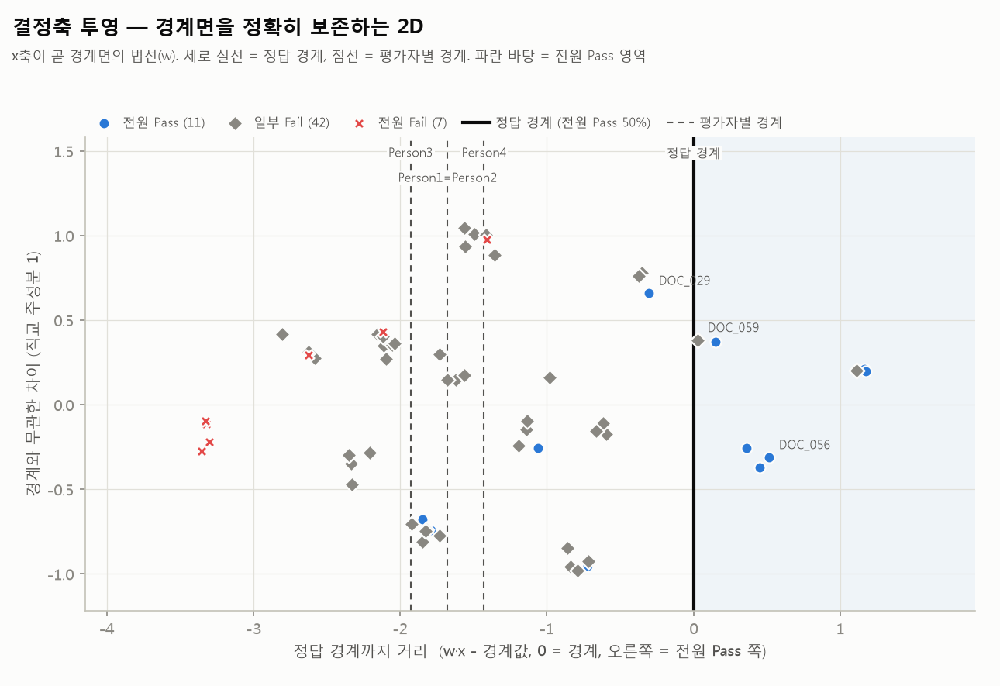
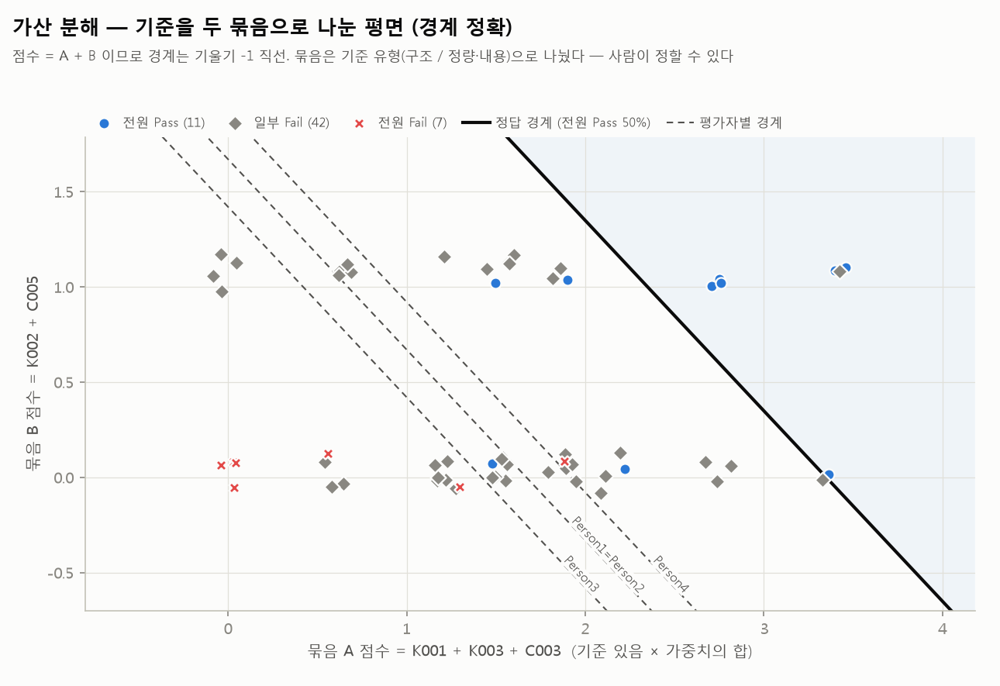
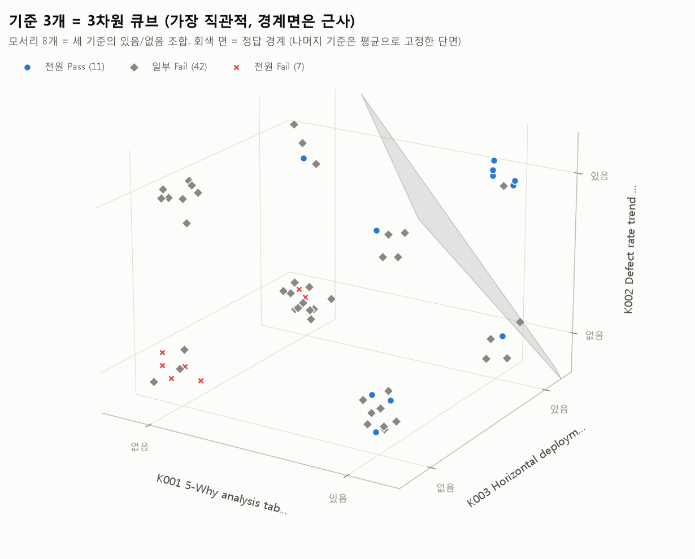
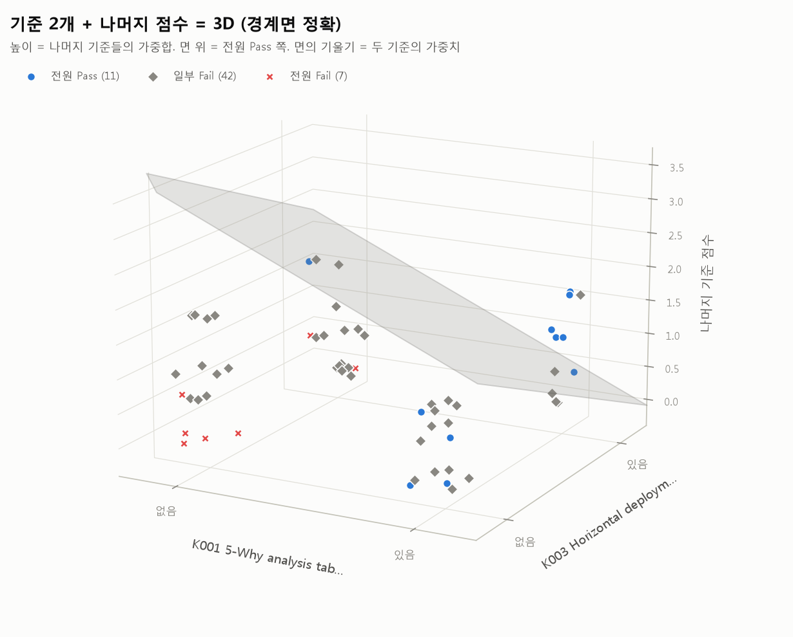
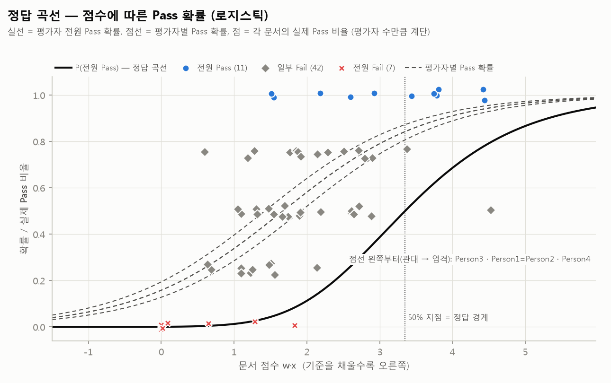
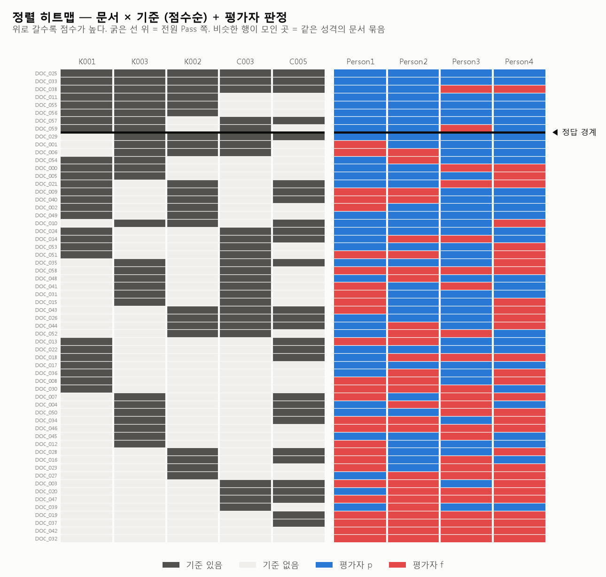
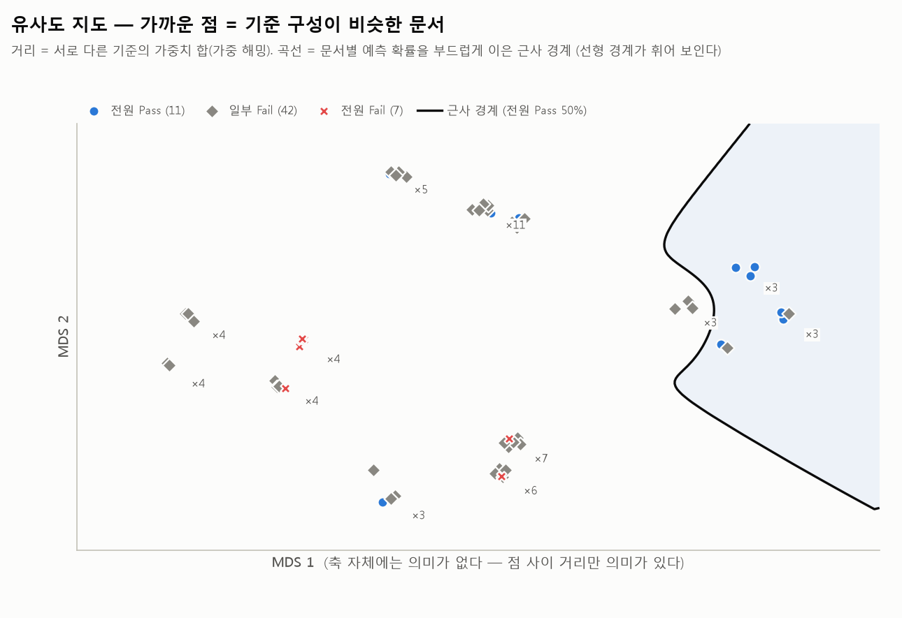
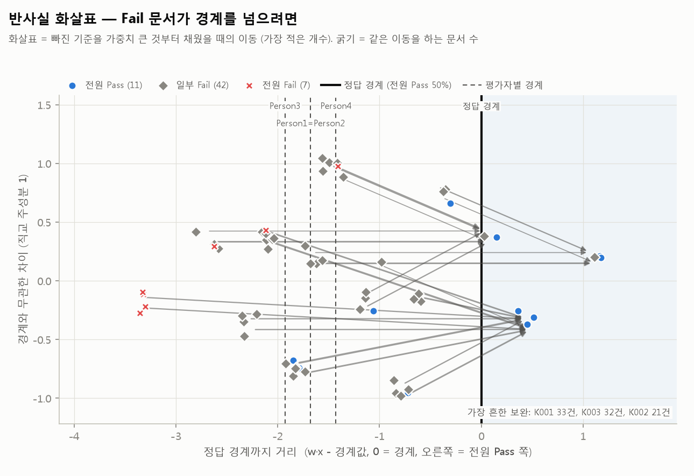

# visualization_options.md — 정답 경계와 문서 간 관계를 보는 방법

> 질문 (2026-10-14): "각 기준이 차원이 되는 것으로 이해했는데, 선형 곡선과 클러스터를 시각화할 방안을 리스트업해 달라.
> 보고 싶은 것은 정답 곡선과 각 파일 간의 관계. 3차원이어도 상관없다."
>
> 미리보기는 확정 입력 형식의 **더미 데이터**(문서 60건, 평가자 4명, 기준 5개)로 그렸다 — 실데이터 결과가 아니다.
> 재현: `python scripts/viz_gallery.py --config <cfg> --out <폴더>` (LLM 호출 없음, 파이프라인 산출물만 읽는다)
> **아직 리포트에 넣지 않았다.** 고른 방안만 `analysis_report.md` 에 통합한다 (§4).

---

## 0. 이해하신 것이 맞다 — 다만 그림이 사진처럼 나오려면 알아야 할 것 3가지

**맞는 부분.** 기준(개념) 1개 = 차원 1개, 문서 1건 = 그 공간의 점 1개다. 정답 곡선은
`w·x + b = 0` 인 경계이고, `w` 의 각 성분이 "그 기준이 Pass 쪽으로 얼마나 미는가"다.
확정 입력에서는 `f(향후 계획 미기입)` 같은 **평가자 사유가 그대로 기준(차원)이 된다** ([`1014_inputdata.md`](1014_inputdata.md) §3).

| # | 알아야 할 것 | 그래서 |
|---|---|---|
| ① | 기준이 예/아니오(0/1)라서 점은 구름이 아니라 **정육면체의 꼭짓점**에 앉는다. 기준 k개면 자리는 2ᵏ개뿐이고, 기준 구성이 같은 문서는 한 점에 겹친다 | 점을 살짝 흔들어(jitter) 그리고 겹친 개수를 표시한다. 사진 같은 "구름"은 기준 여러 개를 가중합한 축(V1·V2)에서 나온다 |
| ② | 기준이 4개 이상이면 경계는 선이 아니라 **면(초평면)**이다. 2D·3D 로 보려면 투영해야 하고, 투영법에 따라 경계가 **정확히** 보이기도 하고 **근사로** 보이기도 한다 | 아래 표의 **"경계"** 열이 가장 중요하다. 근사 그림에서 경계 반대편에 있는 점을 "틀렸다"고 읽으면 안 된다 |
| ③ | 평가자마다 경계가 따로 있다 (엄격한 사람은 오른쪽으로 평행이동). 템플릿의 목표는 **평가자 전원 통과**이므로 정답 경계 = "전원 Pass 확률 50%" 선 | 모든 그림에 정답 경계(실선) + 평가자별 경계(점선)를 함께 그렸다 |

여기서 쓴 모델: 평가자 수준 계층 로지스틱 — 공통 가중치 `w` + 평가자별 절편 `β_r`.
`P(평가자 r 이 Pass) = σ(w·x + b + β_r)`, `P(전원 Pass) = Π_r σ(w·x + b + β_r)`.
(파이프라인의 `analysis.method: hierarchical` 과 같은 모델이다. SVM 이어도 경계 그림은 같은 방식으로 그린다.)

---

## 1. 한눈에 비교

| # | 방안 | 축 | 경계 | 문서 관계 | 3D | 추천 용도 |
|---|---|---|---|---|---|---|
| **V1** | 결정축 투영 | x = 경계까지 거리(`w` 방향), y = 경계와 무관한 차이 | **정확** (세로선) | 중 | 확장 가능 | ★★★ 기본 그림 |
| **V2** | 가산 분해 | x = 기준 묶음 A 점수, y = 묶음 B 점수 | **정확** (기울기 −1 직선) | 중 | — | ★★ 발표용. 보여주신 사진과 가장 비슷 |
| V3 | 기준 3개 큐브 | 상위 기준 3개 그대로 | 근사 (단면) | 하 | ✅ | ★ "기준 = 차원" 설명용 |
| **V4** | 기준 2개 + 나머지 점수 | x, y = 상위 기준 2개, z = 나머지 가중합 | **정확** (평면) | 하 | ✅ | ★★ 3D 를 쓴다면 이것 |
| **V5** | 정답 곡선 (S자) | x = 문서 점수, y = 확률 / 실제 Pass 비율 | **정확** (50% 지점) | 하 | — | ★★★ "곡선" 그 자체 |
| **V6** | 정렬 히트맵 | 행 = 문서(점수순), 열 = 기준 + 평가자 판정 | **정확** (가로선) | **상** | — | ★★★ 실무 점검용. 기준이 많아도 그대로 |
| V7 | 유사도 지도 (MDS) | 문서 간 거리를 보존한 2D | 근사 (휘어짐) | **상** | 가능 | ★ 군집 탐색용 |
| **V8** | 반사실 화살표 | V1 위에 "무엇을 채우면 어디로 가나" | **정확** | 중 | — | ★★ 보완 가이드 설명용 |
| V9 | 인터랙티브 (HTML) | V1·V4·V6 을 회전·확대·마우스오버 | 정확 | 상 | ✅ | ★★ 3D 를 실제로 쓰려면 필수 (미구현, §3) |

> 공통 표기: 파랑 ● = 전원 Pass, 회색 ◆ = 일부 Fail, 빨강 ✕ = 전원 Fail (색만으로 구분하지 않게 모양도 다르게).
> 굵은 실선 = 정답 경계, 점선 = 평가자별 경계, 연한 파란 바탕 = 전원 Pass 쪽.
> 모든 그림의 값은 `viz_points.csv`(문서별 점수·경계까지 거리·확률·기준값)에 표로 같이 나온다.

---

## 2. 방안별 설명

### V1. 결정축 투영 — 경계를 정확히 보존하는 2D ★★★

- **x축 = 경계면의 법선 방향**(`w`). 값은 "정답 경계까지 남은 점수"다. 0 이 경계, 오른쪽이 전원 Pass 쪽.
  그래서 경계가 **반드시 세로 직선**이고, 점이 경계의 어느 쪽에 있는지가 **정확하다**.
- **y축 = 경계와 무관한 차이** — `w` 방향을 뺀 나머지 공간의 첫 주성분. 위아래로 떨어진 점은
  "점수는 비슷하지만 **다른 기준 조합**으로 그 점수를 얻은 문서"다.
- 읽는 법: 경계 바로 왼쪽의 문서(위 그림 DOC_029 등)가 **한두 개만 보완하면 넘어가는 문서**다.
  점선이 오른쪽에 있을수록 엄격한 평가자다(이 더미에서는 Person4).
- 한계: y축 하나에 나머지 차원이 다 눌려 있다. 3D 로 늘리면 직교 주성분 2개를 쓴다(경계는 세로 평면).

### V2. 가산 분해 — 보여주신 사진과 가장 비슷한 평면 ★★

- 기준을 **두 묶음**으로 나눠 각 묶음의 점수(있음 × 가중치의 합)를 x, y 로 쓴다.
  점수 = A + B 이므로 경계는 **기울기 −1 직선**이고 정확하다.
- 묶음은 사람이 의미 있게 정한다. 위 그림은 기준 유형(구조 / 정량·내용)으로 나눴다.
  다른 예: "평가자 사유 기준(K) vs 가설 기준(C)", "섹션 앞부분 vs 뒷부분", "내용 vs 형식".
- 읽는 법: 가로로 가면 A 묶음을 채운 것, 세로로 가면 B 묶음을 채운 것. 대각선을 넘으면 Pass.
  "A 를 덜 채워도 B 를 채우면 된다"는 **보완 관계**가 보인다.
- 한계: 같은 묶음 안의 기준끼리는 구분되지 않는다. 기준이 적으면 점이 몇 줄로 몰린다(위 그림의 위·아래 두 줄).

### V3. 기준 3개 = 3차원 큐브 — 가장 직관적, 경계면은 근사 ★

- 가중치가 큰 기준 3개를 축으로 그대로 쓴다. 꼭짓점 8개 = 세 기준의 있음/없음 조합.
  "기준 = 차원" 을 가장 문자 그대로 보여준다.
- 위 그림에서 회색 면이 **세 기준이 모두 있는 모서리만** 잘라낸다 — "셋 다 있어야 넘어간다"가 한눈에 보인다.
- 한계: 나머지 기준을 평균으로 고정한 **단면**이라 근사다. 나머지 기준이 많을수록 틀린다.
  정적 3D 는 앞뒤가 헷갈린다(면이 점을 가린다) — 실제로 쓰려면 V9(회전)가 필요하다.

### V4. 기준 2개 + 나머지 점수 = 3D — 경계면 정확 ★★

- x, y = 가장 중요한 기준 2개(있음/없음), z = **나머지 기준의 가중합**.
  경계는 `z = 경계값 − w₁x − w₂y` 평면이고 **정확하다**.
- 읽는 법: 면 위 = 전원 Pass 쪽. 면이 x 방향으로 기운 만큼이 기준 1의 가중치다.
  "기준 1을 채우면 필요한 나머지 점수가 이만큼 내려간다"가 보인다.
- 한계: z 축은 여러 기준이 섞인 값이다. 정적 이미지는 V3 와 같은 앞뒤 문제가 있다.

### V5. 정답 곡선 — 점수에 따른 Pass 확률 ★★★

- "정답 곡선" 이라는 말에 가장 가까운 그림이다. x = 문서 점수 `w·x`, y = 확률.
  - 굵은 실선: **평가자 전원 Pass 확률** — 이것이 50% 가 되는 점수가 정답 경계다.
  - 점선: 평가자별 Pass 확률. 왼쪽 곡선일수록 관대하다.
  - 점: 각 문서의 **실제** Pass 비율 (평가자 4명이면 0, ¼, ½, ¾, 1 의 계단).
- 읽는 법: 점들이 곡선을 따라가면 모델이 평가를 잘 설명한다. 곡선에서 멀리 떨어진 점은
  기준으로 설명되지 않는 문서다 — 그런 문서의 사유를 다시 보면 **빠진 기준**을 찾을 수 있다.
- 실선이 점선들보다 한참 오른쪽에 있는 이유: 4명 **모두** 통과해야 하므로 확률이 곱해진다.
  평가자 한 명 기준으로는 넘어도 전원 기준으로는 못 넘는 구간이 템플릿이 메워야 할 구간이다.

### V6. 정렬 히트맵 — 문서 × 기준 + 평가자 판정 ★★★

- 행 = 문서(점수 높은 순), 왼쪽 열 = 기준(가중치 큰 순, 진회색 = 있음), 오른쪽 열 = 평가자 판정(파랑 p / 빨강 f).
  굵은 가로선 = 정답 경계(그 위가 전원 Pass 쪽).
- **문서 간 관계를 가장 정확하게 보여준다.** 투영이 없으므로 기준이 20개, 50개여도 그대로 그린다.
  같은 무늬의 행이 모인 곳 = 같은 성격의 문서 묶음(클러스터).
- 읽는 법: 경계선 근처에서 "기준은 다 있는데 평가자 f 가 있는 행"은 기준 밖의 이유가 있다는 뜻이다.
  행 순서를 점수 대신 **군집 순서**(비슷한 무늬끼리)로 바꾸는 변형도 가능하다.
- 확장: f 셀에 사유 약어를 적거나, 사유가 가리킨 기준 칸에 표시를 하면 **사유와 채점이 맞는지**까지 보인다.

### V7. 유사도 지도 (MDS) — 군집 탐색용, 경계는 근사 ★

- 문서 간 거리(서로 다른 기준의 가중치 합)를 최대한 보존하도록 2D 에 펼친다. 가까운 점 = 비슷한 문서.
  `×11` = 그 자리에 모인 문서 수 (기준 구성이 같거나, 가중치가 작은 기준만 달라 거의 같은 자리인 문서를 합쳐 센다).
- 곡선 = 문서별 예측 확률을 부드럽게 이은 **근사 경계**. 실제 경계는 직선(평면)인데 지도에서는 **휘어 보인다**
  — 비선형 투영의 성질이다. "정답 곡선이 굽었다"고 읽으면 안 된다.
- 변형: t-SNE (scikit-learn 에 있음). UMAP 은 새 의존성이라 R5 승인이 필요하다.
- 한계: 축에 의미가 없다. 거리만 의미가 있다.

### V8. 반사실 화살표 — Fail 문서가 경계를 넘으려면 ★★

- V1 위에, Fail 쪽 문서마다 **빠진 기준을 가중치 큰 것부터 채웠을 때의 이동**을 화살표로 그린다(가장 적은 개수).
  같은 이동을 하는 문서는 한 화살표로 합치고 굵기로 개수를 나타낸다.
- 읽는 법: 오른쪽 아래 "가장 흔한 보완"이 템플릿 필수 요소 후보다. 파이프라인의 반사실 분석(§8.5-7)을 그림으로 옮긴 것이다.
- 한계: 문서가 많으면 화살표가 겹친다 → 대표 문서만 그리거나 V1 과 나란히 둔다.

---

## 3. 3차원을 쓴다면 — 정적 이미지보다 회전 가능한 그림 (V9, 미구현)

정적 3D(V3·V4)는 보는 각도에 따라 면이 점을 가려 **앞뒤가 헷갈린다** (V3 를 다른 각도로 그리면 바로 드러난다).
3D 를 실제로 쓰려면 마우스로 돌려 볼 수 있어야 한다.

| 방법 | 의존성 | 장점 | 단점 |
|---|---|---|---|
| plotly 로 HTML 저장 | 새 패키지 1개 — **사용 승인됨(2026-10-14)**, 추가 시 Windows wheel 확인 | 회전·확대·마우스오버(문서명·사유 표시)가 바로 된다. 파일 하나로 열린다 | HTML 약 4MB |
| 자체 HTML (캔버스 + 순수 JavaScript) | 없음 | 의존성 0, 사내망 오프라인에서도 열린다 | 직접 구현(약 200줄), 기능은 회전·마우스오버 정도 |

어느 쪽이든 문서와 평가 데이터는 **로컬 파일 안에만** 있고 외부로 나가지 않는다 (R1).

---

## 4. 추천 조합과 결정할 것

| 용도 | 추천 |
|---|---|
| `analysis_report.md` 기본 | **V1 + V5 + V6** — 경계가 모두 정확하고, 문서가 많아도 읽힌다 |
| 보고·발표 | **V2** (보여주신 사진 모양) + **V8** (무엇을 보완할지) |
| 3D | **V4** → 회전이 필요하면 V9 |
| 군집 탐색 | **V7** (경계는 근사임을 함께 표기) |

결정된 것 (2026-10-14):

- **3D·인터랙티브 도구: plotly 도 되고 matplotlib 도 된다.** plotly 를 실제로 추가할 때는 R5 절차대로
  Windows wheel(win_amd64, cp311) 존재를 확인하고 requirements.txt 에 고정 버전으로 넣는다.

결정이 남은 것:

1. 리포트에 넣을 방안 (추천: V1, V5, V6 — 원하면 V2·V8 추가)
2. V2 의 묶음 기준 — 기준 유형 / 사유 기준 vs 가설 / 섹션 / 직접 지정
3. 기준을 **0/1 대신 정도(0~1)로 채점**할지 — 점이 꼭짓점에서 풀려 사진 같은 구름이 되고 정보량도 늘지만,
   채점 비용과 일관성 검증(재채점 일치율)이 다시 필요하다

---

## 5. 그림이 말하지 않는 것

- **상관 ≠ 인과.** 경계 오른쪽 문서에 많았던 기준이 "넣으면 합격한다"를 보장하지 않는다.
- **흔든 위치(jitter)는 실제 값이 아니다.** 정확한 값은 `viz_points.csv`.
- **근사 그림(V3·V7)** 에서 경계 반대편의 점을 오분류로 읽지 않는다.
- **평가자 일치도가 낮으면**(이 더미는 α = 0.195) 경계 자체의 의미가 약하다 — 리포트 §3 의 경고를 먼저 본다.
- **사유에서 만든 기준(K…)** 은 평가자 판정에서 나왔으므로 Pass/Fail 을 잘 가르는 것처럼 보이기 쉽다.
  그래서 기준은 발견셋 사유로만 만들고, 사유-채점 일치율과 검증셋 방향을 함께 본다.
- **더미 데이터 그림이다.** 실데이터는 기준이 더 많고 경계 근처가 더 붐빈다 — V1·V6 이 그때 특히 유리하다.
